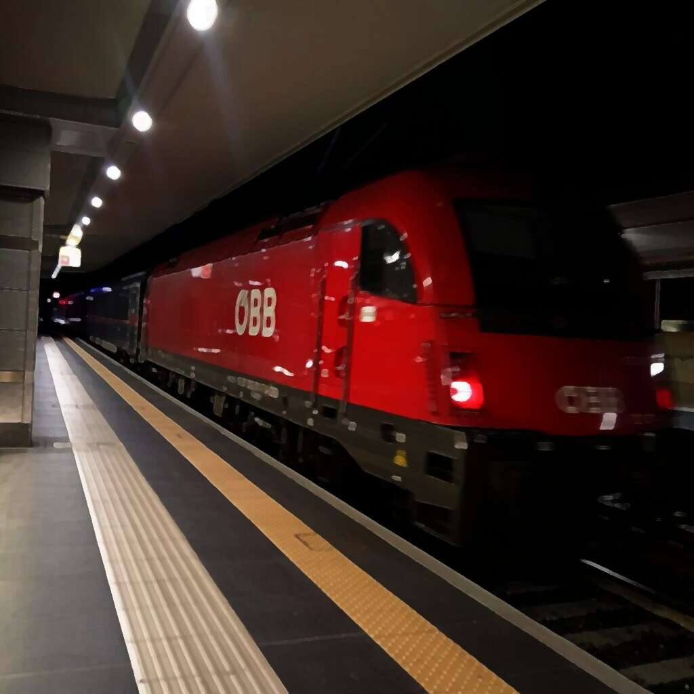

{ align=right width="250" loading=lazy }

Ask five people in the same building what their organisation offers and you get five answers, each of them true inside its own department. The process manager maps a flow nobody outside operations recognises. The customer researcher has a journey map that never reached the steering committee. The enterprise architect keeps a model that says nothing about why customers stay.

EDGY, published at [enterprise.design](https://enterprise.design/) by Intersection Group, is an attempt to put those people around one sheet of paper. It is a small graphical language: four base elements, twelve named elements, three kinds of relationships and three lenses called facets. The first edition, EDGY 23 "Language Foundations", appeared as an open specification under a Creative Commons Attribution-ShareAlike 4.0 licence.

Below is the whole model, one worked example from the documentation, and an honest account of what such a language can and cannot settle.

<!-- more -->

### The problem the language attacks

The argument starts with a familiar observation. Design disciplines work in parallel, and each builds a vocabulary that only its own practitioners read. User experience designers, enterprise architects, organisational designers and business analysts all cover part of the distance between exploration and specification. Where their vocabularies meet, gaps and contradictions appear, and the enterprise as a whole ends up designed by accident.

EDGY answers with four choices its authors state outright. It stays simple, so people learn the structure quickly. It aims to look pleasant, on the assumption that nobody wants to work in a visually hostile tool. It is built from elements and relations instead of layers, which lets you follow dependencies across disciplines. And it stays general on purpose, so specialised languages hook into it without being replaced.

### An enterprise is people with a shared ambition

The definition underneath the language shapes how you use it. An enterprise here is an endeavour of people with a shared ambition, which stretches the concept past the legal entity. A company, a department, an institute or a consortium is an organisation that serves the enterprise, and it seldom covers all of it. Parts of the enterprise sit outside the organisation's control while staying inside its sphere of influence.

That is why the specification writes "we" and "us" when it refers to the enterprise being designed, and why people rather than processes form the starting point.

### Three facets, three arguments

EDGY looks at an enterprise through three lenses, and each lens carries a question a leadership team can genuinely disagree about.

Identity asks why the enterprise exists and what it stands for. It owns purpose, story and content, and it shares organisation and brand with its neighbours.

Architecture asks how the work gets done and what holds it together. It owns capability, process and asset, sharing organisation with Identity and product with Experience.

Experience asks what role the enterprise plays in people's lives. It owns task, journey and channel, sharing product with Architecture and brand with Identity.

Each facet therefore names five elements: three of its own and two that sit where it overlaps a neighbour. Those overlaps carry names, and they are where most cross-disciplinary trouble lives. Organisation sits between Identity and Architecture and asks how people shape their collaboration. Product sits between Architecture and Experience and asks what the enterprise makes and what value that creates for people. Brand sits between Experience and Identity and asks how the enterprise is perceived when people meet it.

Facets work as lenses rather than boxes. You can lay all three over the same part of the enterprise and see different things. The documentation keeps pointing at that interplay: an architecture that delivers the quality a brand promises, or a mission statement that matches the experience people actually have.

### Twelve elements and four base elements

The vocabulary is short, and it follows the facets.

On the identity side, purpose is the reason the enterprise exists and what people pursue and believe in. Story is how people make sense of the enterprise and explain what it does. Content is what gets communicated to people, in information and media.

On the architecture side, capability is what the enterprise can do by orchestrating people and assets. Process is a set of related activities it carries out, and asset is an object it needs to perform those capabilities.

On the experience side, task is what people want to achieve and get done. Journey is the run of events and activities people live through. Channel is the means they use to engage and interact.

Three elements sit in the overlaps. Organisation is a group of people working together, product is what the enterprise makes and delivers for people's benefit, and brand is the name and what it stands for.

Underneath those twelve sit four base elements that work across every facet: people, outcome, activity and object. Anything happening in or around an enterprise can be described with those four alone. The authors point to the FBS ontology here, where outcomes stand for function, activities for behaviour and objects for structure.

Three relationships connect the lot. A link is a plain association, optionally directional and named. A flow carries behaviour, sequence and objects from one element to another. A tree expresses containment or aggregation between a parent and a child of the same kind. Labels then add detail: tags distinguish types of an element, metrics attach a quantity or quality to it.

### What EDGY is not

The specification answers this directly, and the answer keeps expectations realistic. EDGY does not replace ArchiMate, BPMN, SAFe or a service blueprint. It frames the strategic context in which those languages do their precise work. The published mapping to ArchiMate 3.2 uses that language's specialisation mechanism, so an EDGY model can live inside a repository tool with ArchiMate as an invisible backbone.

Tooling exists in several shapes: stencils for Miro, example maps for diagrams.net, SVG shapes, a PlantUML library, and commercial support in Lyster and QualiWare. Around the language, Intersection Group added an Enterprise Scan of nineteen questions, Capability Modelling Guidelines and thirty-five practice patterns. New editions keep arriving, so the wiki is a moving target.

### A practical example: the night train

The documentation teaches the model through one fictional enterprise, Intersection Railways, a former state railway in a small European country. Its longest worked example is worth walking through, because it shows what the facets buy a project before anyone designs anything.

An agency wins a bid to strengthen the railway's digital offering and puts Severin, a service designer, in the lead. In his first meeting with Mary, who leads the project internally from marketing and communication, two things land on the table. Commercially the plan is to bring back night trains, aimed at existing train travellers as well as at people who currently fly or drive. And the route to those customers is a world-class digital experience, a new app in the spirit of an "Apple iTrain".

Severin likes the ambition and spots the flaw. The proposition leans on digital channels while the physical service sits elsewhere: the coaches, the cabins, the on-board staff, the support desk at two in the morning. Mary confirms it. Digital is high on the leadership agenda, a new digital strategy guides further work, and coordination between the two teams will be arranged.

Rather than argue, Severin proposes to start with an Enterprise Scan. Its stated aim is a shared picture of the product and alignment on what will be delivered. His private aim is to widen the scope.

Six people take part. Monica heads sales and sponsors the work, David owns the digital strategy, Peter owns the existing app, Petra owns the night train, Earnestine is the enterprise architect for infrastructure, and Mary leads the project from marketing. All six answer nineteen questions individually before the workshop, and the answers go into a comparison.

That comparison is where the project changes shape. Answers diverge on tasks, capabilities and organisation, and even where people agree on the surface, their elaborations show different readings of the same initiative. The three people who matter most are the least aligned: Monica assumes the assignment is reasonably clear, Petra has listed problems that need analysis, and Earnestine knows little about the whole thing.

The workshop that follows gets three hours for nineteen questions, so Severin reorders the discussion. He takes people, experience and purpose first, then product and brand, and leaves architecture and organisation for last. A new customer offering is hard to discuss technically before anyone agrees who is served and with what. The outputs are telling. The purpose needs sharper definition. Stories and content are unclear. Two brands are in play, with unclear consequences. Product turns out to be multifaceted and unfinished. Architecture and organisation get parked until the other questions have moved.

The priorities that come out put tasks, purposes and brands first, each with a named owner, then reuse of existing journey, channel, story and content material, and a check on which stakeholders the group is missing.

Nothing was designed in that session. What the scan produced was a scope correction, reached by the people who would live with it: the digital app could not be specified apart from the physical service, the brands and the reasons behind the project.

### Drawing the first map

For the night train case the next map is easy to describe, and that is the point of a language this small. You place a handful of elements on one page and connect them.

People: the leisure traveller heading for the mountains, the business traveller avoiding an early flight, the family with children. Tasks: arrive rested, keep the trip affordable, sleep without worrying about the connection. Journey: discover, book, prepare, board, sleep, breakfast, arrive. Channels: the app, the station counter, the travel agent.

Product: the night train service, cabin categories included, plus the digital layer around it. Capabilities: on-board hospitality, rolling stock maintenance, pricing, disruption handling. Processes: nightly departures, border checks, cleaning between runs. Assets: locomotives and carriages, the reservation system, station facilities. Purpose, story and brand sit on the identity side of the page, and they are the first things to sharpen.

Three relationships wire it up. A tree from the product down to its cabin categories, flows from task to journey to channel, links between a capability and the assets that carry it. Tags separate customer segments, and metrics attach a price, a delay figure or a satisfaction score.

That map is not a deliverable. It is a conversation aid, and it earns its keep because a marketing manager, an architect and a product owner can all read it.

### Where the language stops

A shared vocabulary does not settle politics. The scan made the misalignment visible and handed Severin a mandate to discuss scope, yet the digital-only framing came from the leadership agenda, and no diagram overrules a strategy that has already been signed off. The pattern collection is candid about this, with corporate politics and unintended consequences among its thirty-five subjects.

Loose modelling has a second cost. Three relationship types and a dozen elements keep the threshold low, and they keep traceability modest at the same time. Teams that need audit-grade repositories, versioning and formal conformance pair EDGY with ArchiMate or a repository tool, which is exactly what the mapping exists for.

The third risk is decorative. Simple, colourful maps are pleasant to produce, and a wall of them proves nothing. The value sits in the argument the map forces: which tasks, whose journey, which capability is missing, which brand promise the architecture cannot keep.

### Starting small

The getting-started guide is direct about the learning curve. Read the foundations first, then try the facets in conversations you already have, on a part of the enterprise you know well. Start small and low-stakes, find someone experienced to work with, and iterate.

The Enterprise Scan gives that first conversation a structure, and the example maps open in draw.io if you would rather edit than copy a picture.

For anyone who has sat through an architecture review where half the room used a different word for the same thing, the appeal is obvious. EDGY adds no analytical power to your models. It gives the people holding those models a reason to sit at the same table.

### Sources

- [Enterprise Design with EDGY (home)](https://enterprise.design/)
- [EDGY: About](https://enterprise.design/wiki/EDGY:About)
- [Getting started](https://enterprise.design/wiki/Getting_started)
- [Enterprise Design](https://enterprise.design/wiki/Enterprise_Design)
- [Enterprise Design Facets](https://enterprise.design/wiki/Enterprise_Design_Facets)
- [Enterprise Elements](https://enterprise.design/wiki/Enterprise_Elements)
- [Base Elements](https://enterprise.design/wiki/Base_Elements)
- [Relationships](https://enterprise.design/wiki/Relationships)
- [EDGY with ArchiMate](https://enterprise.design/wiki/EDGY:ArchiMate)
- [EDGY Tools](https://enterprise.design/wiki/EDGY:Tools)
- [Enterprise Scan](https://enterprise.design/wiki/Enterprise_Scan)
- [Enterprise Scan: example](https://enterprise.design/wiki/Enterprise_Scan:_Example)
- [Enterprise Design Patterns](https://enterprise.design/wiki/Patterns)
- [Capability Modelling Guidelines](https://enterprise.design/wiki/Capability_Modelling_Guidelines)
- [Intersection Group: Enterprise Design with EDGY](https://intersection.group/enterprise-design/enterprise-design-with-edgy/)
- Header image: [ÖBB Nightjet train in Bologna](https://commons.wikimedia.org/wiki/File:%C3%96BB_Nightjet_train_(Bologna)_in_2025.01.jpg) — Wikimedia Commons (CC0), painterly filter
