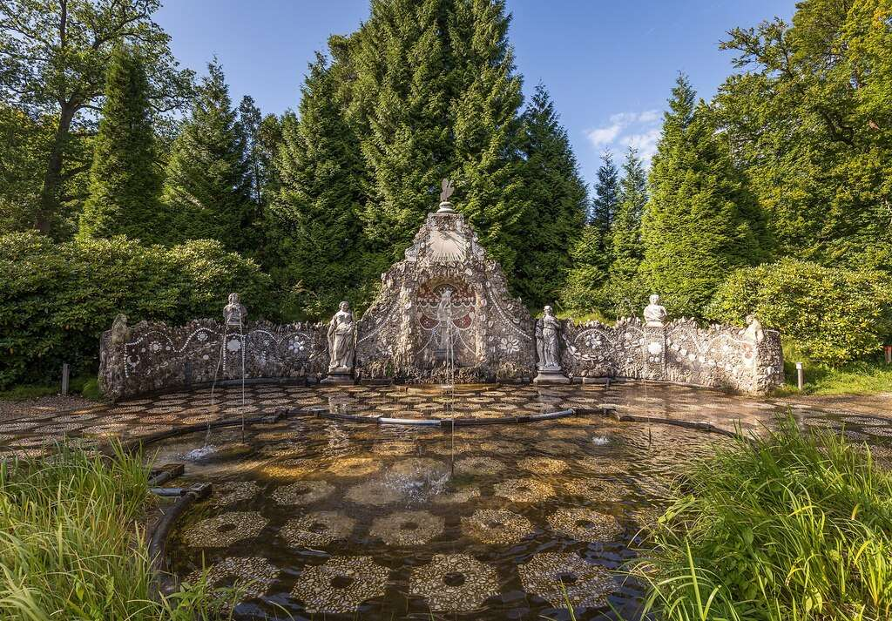

{ align=right width="250" loading=lazy }

In het park van kasteel Rosendael in Rozendaal, net boven Velp, ligt een vloer van mozaïek die er onschuldig uitziet. Tot er ergens een straal water omhoog schiet, en nog een, en nog een, op plekken waar je ze niet verwacht. Kinderen rennen er gillend doorheen, ouders kijken vanaf de rand toe en weten dat ze niet te dichtbij moeten komen.

Die fonteintjes heten de bedriegertjes, en ze doen dat al sinds de achttiende eeuw.

<!-- more -->

### Wat er precies in de grond zit

De bedriegertjes zijn geen grote fonteinen maar een reeks kleine spuitmondjes, verwerkt in de vloer van de waterpartij bij de schelpenwand. Ze staan niet constant aan. Ze springen met tussenpozen aan, zodat je nooit weet waar het volgende straaltje vandaan komt. Wie rustig over de vloer loopt, komt droog over. Wie blijft staan om te kijken, wordt nat.

De naam zegt het al: het zijn kleine bedriegers. In het Engels heet dit type fontein niet voor niets een trick fountain of, in de Amerikaanse vertaling van de Nederlandse benaming, een cheater fountain.

Ze zijn geen speeltuintje dat later is toegevoegd. De bedriegertjes met schelpenwand staan zelf op de monumentenlijst, als rijksmonument nummer 528477, en maken deel uit van het beschermde complex Historische buitenplaats Rosendael. Dat complex telt eenentwintig afzonderlijke rijksmonumenten, van het hoofdgebouw en de historische tuin- en parkaanleg tot de theekoepel, de schelpengalerij, de cascade met stroomgoden, de schelpengrot en de oude ijskelder. Het geheel staat in de Top 100 van de Rijksdienst voor de Monumentenzorg.

### Waar het water vandaan komt

Wat de bedriegertjes bijzonder maakt, zit onder de grond. De Veluwezoom is rijk aan sprengen en beken. Het gebied ligt hoog, het IJsseldal ernaast laag, en dat hoogteverschil betekent waterdruk. Eeuwenlang gebruikte Rozendaal die druk voor drinkwater, voor de grachten om de huizen en voor de molens langs de Rosendaelse beek. Volgens de streekpromotie stonden er ooit zeven watermolens, zes papiermolens en een korenmolen tegelijk aan die beek.

Diezelfde druk maakte iets anders mogelijk. Waar een vlakke polder een strak geometrisch tuinontwerp toelaat, zoals in de zeventiende eeuw in zwang was, dwingt een heuvelachtig terrein tot terrassen en trappen. Rozendaal koos voor het tweede, en gebruikte het verval voor watervallen, cascades en fonteinen die zonder pomp werkten. Het landgoed was er in de zeventiende en achttiende eeuw om vermaard. Constantijn Huygens, de dichter en secretaris van Willem III, bezocht het park en noemde het in 1678 een groen hemeltje op aarde.

Dat is ook de eerlijkheid over de techniek: de aandrijving is natuurlijke waterdruk, geen elektriciteit. Hoe de spuitmondjes vervolgens op hun beurt worden geschakeld, staat in de openbare bronnen niet uitgelegd. Wie daar nieuwsgierig naar is, moet bij Geldersch Landschap en Kasteelen aankloppen, niet bij Wikipedia.

### De heren, de erfenis en de architect

Het kasteel zelf is ouder dan de tuin. Rozendaal wordt in 1314 voor het eerst genoemd, en de bouwers waren de graven van Gelre, na 1339 hertogen. Zowel Reinoud I als Reinoud II woonde er. Wat van de middeleeuwse burcht over is, is de donjon: oorspronkelijk ongeveer 25 meter hoog, met een diameter van 16 meter en muren tot vier meter dik. Daarmee is het de grootste toren in zijn soort in Nederland, en ook de dikste.

Daarna ging het gebouw van hand tot hand. In 1536 ruilde drost Willem van Scherpenzeel het kasteel tegen zijn eigen slot Coldenhove. In 1579 verkocht hij het aan Dirck van Dorth, die veel aan het kasteel veranderde en de tuinen, vijvers en beken liet aanleggen. Daarna kwamen de families Van Arnhem, Torck en Van Pallandt.

De man die de tuin zijn barokke gezicht gaf, was Lubbert Adolf Torck. Hij was getrouwd met de schatrijke Petronella Wilhelmina van Hoorn, en vanaf 1720 betaalde hij de Franse architect Daniël Marot om op Rosendael te werken. Marot had naam gemaakt aan Het Loo, en in Rozendaal ontwierp hij waarschijnlijk de theekoepel en de waterornamenten, waaronder de cascade met de stroomgoden. Die cascade dateert van rond 1725. Beeldhouwer Michiel Moser maakte de figuren die op kruiken liggen waaruit water stroomt, mogelijk Neptunus en Mercurius.

In 1732 werden de tuinen opnieuw aangelegd onder Marots architectuur. In diezelfde jaren kwam er ook een vierkant huis tegen de middeleeuwse toren, waarmee Rosendael van een kasteel veranderde in een buitenplaats.

### De vorm van nu is jonger dan het idee

Over de datum van de bedriegertjes lopen de bronnen uiteen, en dat is het vermelden waard. De gangbare lijn is dat ze uit de achttiende eeuw dateren en bij de waterpartijen van Marot horen. Maar de vorm die je vandaag ziet, met de schelpenwand en de mozaïekvloer, is jonger.

In 1836 maakte landschapsarchitect Jan David Zocher jr. het ontwerp voor het huidige park. Hij voegde verschillende kleinere vijvers samen tot één grote en nam de speelse onderdelen van de oude tuin, waaronder de bedriegertjes en de schelpengrot, op in zijn nieuwe ontwerp. Bij die gelegenheid kregen de fonteintjes hun nieuwe achterwand van schelpen en hun mozaïekvloer. De Nederlandse Wikipedia situeert de aanleg zelfs in de negentiende eeuw, in de tijd van de familie Van Pallandt, terwijl andere bronnen het bij de achttiende eeuw houden.

Het is dezelfde vraag als bij een oud huis dat in 1900 is verbouwd: wat dateert van de bouw en wat van de verbouwing? Het antwoord is hier dat het idee achttiende-eeuws is en de uitvoering die je ziet negentiende-eeuws.

### Waarom een fontein die je natmaakt

Een verrassingsfontein lijkt een grap, en dat is het ook. Maar hij past in een serieuze traditie. Op buitenplaatsen in heel Europa was water in de zeventiende en achttiende eeuw een statussymbool: hoe meer druk, hoe meer spektakel, hoe indrukwekkender de gastheer. Vorsten en edelen lieten fonteinen bouwen die hun bezoekers verrasten, natspuiten of lieten schrikken. Het vernuft was het vermaak, en de gast die nat werd, had iets te vertellen.

Rosendael deed daar aan mee, op een schaal die bij een Gelderse buitenplaats paste. De schelpenwand, de grot, de theekoepel en de cascade met stroomgoden vormen samen één programma waarin water, ornament en verrassing dezelfde rol spelen. De bedriegertjes zijn daarvan het speelsste onderdeel. Ze zijn ook het enige dat je nog kunt doen in plaats van alleen bekijken.

### Van oerbeeld naar gemeenteplein

Het type is in Nederland breed nagevolgd. Rozendaal geldt in die zin als het oerbeeld. De ClimateScan-database, die waterplekken inventariseert, noemt de bedriegertjes in Rozendaal expliciet als het oorspronkelijke voorbeeld van dit fonteintype. Daarnaast noemt hij moderne varianten in Elst, op het Nijmeegse Koningsplein (1999) en op de Grote Markt in Groningen (2023).

Dat is een aardige ontwikkeling: een achttiende-eeuws adellijk vermaak dat in de eenentwintigste eeuw op gemeentepleinen staat, waar het dezelfde functie heeft als altijd. Kinderen nat maken op een warme dag.

### Oorlog, verval en een stichting

Na de Tweede Wereldoorlog ging het mis. Het kasteel werd geraakt door een Amerikaanse bom, en het park raakte deels verwoest door een verdwaalde V2-raket. Het landgoed verviel, tot de laatste baron, Willem Frederik Torck baron van Pallandt, het in 1977 overdroeg aan de stichtingen Het Geldersch Landschap en Vrienden der Geldersche Kasteelen.

Daarna werd het landhuis gerestaureerd en de tuin hersteld. Rond 1985 kwam ook de bibliotheek aan de beurt, met ongeveer drieduizend boeken en manuscripten, waaronder werk van de Zweedse koningin Christina dat aan René Descartes was gericht. Sinds 1989 is een deel van het kasteel voor publiek open. Kasteel en park behoren inmiddels tot het vaste aanbod van Geldersch Landschap en Kasteelen, dat zeven Gelderse kastelen beheert.

### Er naartoe

Het park is te bezoeken zonder het kasteel in te gaan, en de bedriegertjes liggen in de open lucht. Geldersch Landschap en Kasteelen houdt park en kasteelwinkel open van dinsdag tot en met zondag, van 11.00 tot 16.00 uur. Kasteelrondleidingen zijn er op dinsdag tot en met zaterdag om 11.00, 12.30, 13.00 en 14.30 uur en op zondag om 11.00 uur. Op zondag tussen 12.30 en 16.00 uur kun je het kasteel ook op eigen gelegenheid bezoeken.

Eén praktische waarschuwing, en die is serieus: trek geen schoenen aan die niet tegen water kunnen. De bedriegertjes doen precies wat hun naam belooft.

### Bronnen

- [Kasteel Rosendael en park, Geldersch Landschap en Kasteelen](https://rosendael.glk.nl/)
- [Kasteel Rosendael, Wikipedia (NL)](https://nl.wikipedia.org/wiki/Kasteel_Rosendael)
- [Watergespetter in park van kasteel Rosendael, Dag van het Kasteel](https://dagvanhetkasteel.nl/watergespetter-in-park-van-kasteel-rosendael/)
- [Rosendael Castle, Holland.com](https://www.holland.com/global/tourism/destinations/provinces/gelderland/rosendael-castle.htm)
- [Castle Rosendael, Atlas Obscura](https://www.atlasobscura.com/places/castle-rosendael)
- [Bedriegertjes, Rosendael, Aroundus](https://aroundus.com/p/11888607-bedriegertjes-rosendael)
- [Bedriegertjes en moderne varianten, ClimateScan](https://climatescan.org/projects/9027/detail)
- [Rozendaal en de Rosendaelse beek, VVV Arnhem Nijmegen](https://arnhemnijmegenregion.com/rozendaal)
- Foto: [Kasteel Rosendael, Bedriegertje met Schelpenwand](https://commons.wikimedia.org/wiki/File:Kasteel_Rosendael,_Bedriegertje_met_Schelpenwand.jpg) door Davidh820, Wikimedia Commons (CC BY-SA 4.0)
