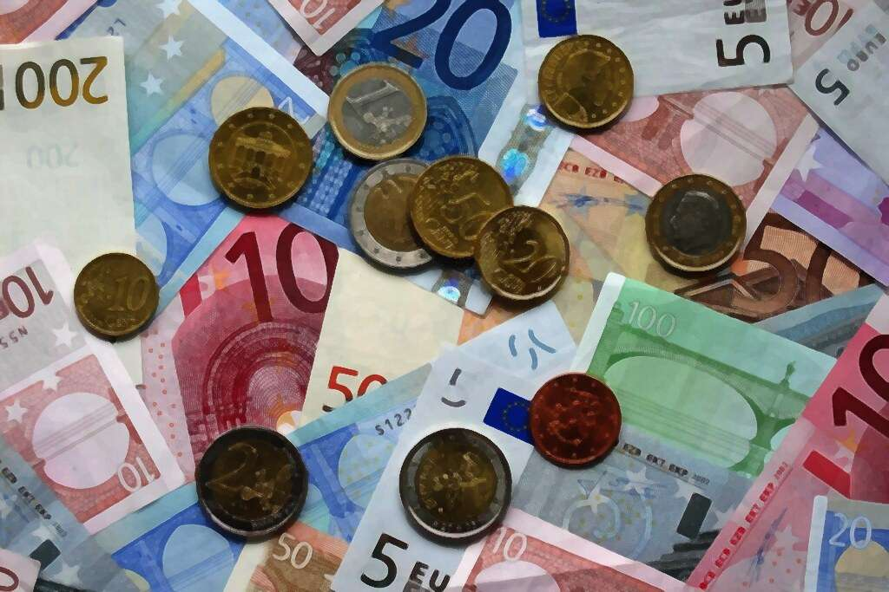

{ align=right width="250" loading=lazy }

In Den Haag ligt een wetsvoorstel om 1,5 miljard euro aan lasten te verschuiven van arbeid naar vermogen. Pro en Volt dienden het in, de VVD wijst het af en D66 wil erover praten, zo bleek tijdens het debat over het belastingplan in de eerste week van november. In diezelfde weken ging een gesprek rond van De Nieuwe Wereld. Daarin bepleit Jean-Paul Fonteijn dat niemand meer dan 10 miljoen euro vermogen zou mogen hebben, met een heffing van 30 procent op alles daarboven.

Beide debatten draaien om dezelfde vraag: hoeveel vermogen kan zich bij één huishouden ophopen, en wat vraagt de samenleving daarvan terug? Het antwoord is tot nu toe een bedrag en een percentage. Daaronder ligt een rekenkundige vraag. De cijfers in dit artikel komen uit één uitgewerkte variant van zo'n heffing, hier verder het voorstel genoemd: een staffel met vier schijven, een exitheffing bij emigratie en zeven regels die de lobby beperken, doorgerekend op Nederlandse cijfers.

Het eerste punt is rekenkundig. Een bedrag van 10 miljoen valt samen met een statistisch snijpunt: het is ongeveer de lijn waarboven de rijkste 0,1 procent van de Nederlandse huishoudens begint. Het getal 10 is daarmee te herleiden tot een verdeling. Het tweede punt is politiek. Over een heffing op vermogen wordt onderhandeld met een Kamer, en rond de groep die betaalt staan professionele belangenbehartigers.

<!-- more -->

## Wat één bedrag verbergt

Begin bij de cijfers. Het CBS meldde in maart 2025 dat de 10 procent meest vermogende huishoudens 56 procent van het Nederlandse vermogen bezitten. De top 0,1 procent, zo'n 8.200 huishoudens, had samen 260 miljard euro, bij een totaal huishoudvermogen van 2,6 biljoen.

Het mediane vermogen per volwassene lag in 2025 op 127.407 dollar in Nederland, meldt het UBS Global Wealth Report 2026. Tien miljoen euro is daar ongeveer 88 keer de mediaan. Zet dezelfde grens naast de wereldmediaan van ruwweg 10.000 dollar en je komt op ruim duizend keer. Eén bedrag, twee betekenissen.

Reken je de Nederlandse staart door als Pareto-verdeling, dan ligt de drempel van de top 0,1 procent tussen 9,1 en 14,1 miljoen euro. Die bandbreedte hangt af van hoe dik je de staart aanneemt. Fonteijns 10 miljoen valt midden in die band. Het getal is dus niet willekeurig, maar het is wel een nationaal kwantiel dat als morele grens wordt gepresenteerd.

Een alternatief dat in de literatuur terugkomt, is de grens als formule te behandelen. Neem T = k × M, met M het mediane netto vermogen per volwassene van een land en k de enige politieke keuze. Bij k = 100 hoort een drempel van 11,4 miljoen euro in Nederland. In Duitsland is dat 4,8 miljoen, in de Verenigde Staten 6,2 miljoen en in België 24,7 miljoen. De regel is overal dezelfde, het bedrag volgt de welvaart van het land, en de drempel beweegt mee met de bevolking en de groei in plaats van te verstoffen.

## De staffel, en wat hij oplevert

Een grens alleen doet niets; het tarief bepaalt wat er gebeurt. Het voorstel kent vier schijven. Vrij tot 50 keer de mediaan, daarna 0,5 procent, 2 procent en 5 procent. Boven duizend keer de mediaan geldt 8 procent. Altijd marginaal op het overschot, nooit op het hele vermogen.

In Nederland raakt die staffel ongeveer 20.850 huishoudens, een kwart procent van het totaal. De opbrengst in het eerste jaar komt op 8,93 miljard euro, 0,78 procent van het bruto binnenlands product. Het effectieve tarief over het overschot boven de eerste drempel blijft steken op 3,67 procent. Een staffel pakt in de praktijk dus veel vlakker uit dan de bovenste schijf suggereert.

Interessanter dan de opbrengst is wat de tariefstructuur met de staart doet. Waar het marginale tarief boven het verschil tussen rendement en groei uitkomt, krimpt het overschot. In deze variant gebeurt dat vanaf 250 keer de mediaan, ongeveer 28,4 miljoen euro. Een vermogen van 100 miljoen groeit daarna netto nog 0,05 procent per jaar; een vermogen van een miljard krimpt met 3,55 procent per jaar.

Een plafond in de wet is dan niet nodig. Het evenwicht volgt uit de tarieven en ligt rond 250 tot duizend keer de mediaan. Critici van een harde kap wijzen erop dat het marginale rendement bij die grens nul is, waardoor geld kan verhuizen naar stichtingen, kunst of een ander land.

De opbrengst daalt in latere jaren, want boven de drempels blijft steeds minder over. En de 8,93 miljard is een ondergrens, omdat het CBS de top structureel ondertelt. De Quote 500 alleen al telt 500 mensen met 241 miljard euro, meer dan het CBS aan de hele top 0,1 procent toeschrijft.

## Het tarief is de echte keuze

Het verband tussen tarief en uitkomst is rekenkundig vast te leggen. Een vermogensstaart groeit autonoom met ongeveer 4 procent per jaar, het verschil tussen rendement en economische groei. Een tarief daaronder laat de staart groeien.

Bij 5 procent krimpt het overschot met 1 procent per jaar, goed voor een halfwaardetijd van 69 jaar. Bij 8 procent is dat 17 jaar, bij 10 procent 12 jaar en bij 30 procent 2,7 jaar. Met een gekozen termijn ligt het tarief daarmee vast.

Bij het tarief van 30 procent dat Fonteijn noemt, vraagt de heffing in jaar één in Nederland ongeveer 53 miljard euro, 4,6 procent van het bbp, vrijwel volledig uit aandelen en vastgoed. Dat bedrag moet in één jaar vrijkomen, en de prijs van het onderpand wordt dan mede door de heffing bepaald.

Ook de vorm van de betaling telt mee. Uitstel zonder rente verlaagt het effectieve tarief: een heffing van 5 procent die twintig jaar renteloos wordt uitgesteld op een illiquide familiebedrijf, is bij 7 procent rendement nog 1,29 procent waard. Uitstel met rente of met een waarderingskorting houdt dat gat dicht.

## De exitheffing als sluitstuk

Fonteijn noemt zelf het bezwaar dat een land dat alleen begint zijn eigen vermogenden verliest aan landen die niet meedoen. Daar bestaat een juridisch antwoord op, en dat is ouder dan het debat zelf. Het Hof van Justitie oordeelde in National Grid Indus (C-371/10, 29 november 2011) dat een exitheffing is toegestaan, mits de invordering wordt uitgesteld zolang de bezittingen in de gaststaat blijven. Nederland voerde daarop in 2013 een uitstelregeling in.

De machinerie is dus aanwezig, alleen smal. Nederland kent de fictieve vervreemding bij emigratie voor houders van een aanmerkelijk belang (artikel 4.16, eerste lid, onderdeel h, Wet IB 2001), met een conserverende aanslag. Duitsland heft op grond van paragraaf 6 AStG bij emigratie van houders van een belang van 1 procent of meer, en er ligt een wijzigingsvoorstel open. Frankrijk kent artikel 167 bis van de Code général des impôts, Spanje de Solidariteitstaks Grote Vermogens sinds 2023 op vermogen boven 3 miljoen euro.

Voor bedrijven bestaat er zelfs al een Europese exitheffing, in artikel 5 van de ATAD-richtlijn uit 2016. De vraag aan een land wordt daarmee kleiner: het bestaande instrument breder trekken in plaats van een nieuw bouwen. Ze ligt bovendien op een plek waar de wet al wordt herzien.

Dat vertrek niet theoretisch is, bleek in Noorwegen. Na de verhoging van de vermogensbelasting in 2022 vertrokken meer dan dertig miljardairs en multimiljonairs. Het land schrapte daarop de termijn van vijf jaar op de exitheffing, zodat verhuizen geen kwijtschelding meer is.

## Internationaal: drie cijfers en één deadline

De Europese doorrekening bestaat. Het EU Tax Observatory becijferde in maart 2025 dat een minimumheffing van 2 procent op vermogen boven 100 miljoen euro in de EU 67 miljard euro per jaar oplevert. Een licht progressief tarief van 3 procent komt op 121 miljard. Bruegel raamde de Europese investeringsbehoefte op 250 miljard per jaar, en volgens een Eurobarometer-peiling steunt 67 procent van de Europeanen dit soort instrumenten.

Wereldwijd rekent de blauwdruk die Gabriel Zucman in juni 2024 voor het G20-voorzitterschap schreef, op 200 tot 250 miljard dollar per jaar bij 2 procent boven 1 miljard dollar. Mechanisch, op de Forbes-lijst van maart 2026 met 3.428 miljardairs en 20,1 biljoen dollar, is dat 333 miljard. Het gat tussen die twee getallen is de ontwijkingsmarge die een ontwerp moet dichten.

Bij de winstbelasting ging het zo. Ruim 140 landen bereikten in 2021 een akkoord over een mondiale minimumbelasting van 15 procent. In het zogeheten side-by-side-pakket van 5 januari 2026 werd die buiten toepassing verklaard op Amerikaanse multinationals. Voorstanders van een vermogensheffing leiden daaruit af dat de bijheffing zo gebouwd moet worden dat zo'n uitzondering duur wordt.

De eerstvolgende gelegenheid met een datum ligt bij de Verenigde Naties. Op 20 juli 2026 publiceerde de VN een ontwerp-kaderverdrag over internationale belastingsamenwerking plus twee ontwerp-protocollen, met de bedoeling in 2027 drie juridische instrumenten vast te stellen. De zesde onderhandelingsronde loopt van 30 november tot 10 december 2026 in Nairobi. Wie dit onderwerp internationaal wil agenderen, heeft daar één kans en daarna een jaar niets.

## De lobbyrem: zeven onderdelen in dezelfde wet

Tot hier is het een belastingontwerp. Het tweede probleem is dat de groep die betaalt georganiseerd is, en dat is meetbaar. In de Verenigde Staten werd in 2025 voor 5,08 miljard dollar aan federale lobbying gemeld, met 13.715 geregistreerde lobbyisten, van wie 86,6 procent voor het bedrijfsleven werkt. In het EU-transparantieregister staan ruim 17.600 organisaties.

Nederland is geen uitzondering, al zijn de bedragen kleiner. Sinds 1 januari 2023 zijn donaties vanaf 1.000 euro openbaar en geldt een maximum van 100.000 euro per donateur per jaar. Giften van buiten de EU en de EER zijn verboden. Bij Donorscope staat een stichting geregistreerd die in totaal 2,2 miljoen euro schonk aan campagnes van de VVD. Het plafond geldt per persoon, en de stichtingsroute komt er dus langs.

In Frankrijk geldt 4.600 euro per persoon per verkiezing; rechtspersonen mogen niets geven en de uitgavenplafonds liggen op 16,9 en 22,5 miljoen euro per presidentscampagne. In Californië werd in november 2026 een eenmalige heffing van 5 procent op het vermogen van miljardairs verworpen met 52,8 procent tegen, na zware campagnes van techondernemers. Een populair idee kan dus worden weggestemd als de tegenkant meer geld heeft.

In het voorstel staat de lobbyrem in hetzelfde wetsvoorstel als de heffing. Zeven onderdelen worden daarin genoemd.

- Een donatieplafond van 500 euro per partij per jaar, met een verbod voor rechtspersonen.
- Verdriedubbeling van kleine giften uit een publiek budget.
- Een lobbyregister dat toegang tot het parlement als voorwaarde stelt.
- Herkomstregistratie bij elk amendement.
- Een draaideurverbod van drie jaar.
- Openbaarmaking van bezittingen, met onthouding van stemming.
- Een handhavende dienst met eigen budget en anti-SLAPP-wetgeving.

Dat pakket kent bekende zwaktes. Donatieplafonds verplaatsen geld naar stichtingen en denktanks, registers worden ontweken door niet te registreren, en recusatie leidt tot stromannen. Elk onderdeel vraagt daarmee een tegenklep, en geen ervan is waterdicht.

## De tegenkant

Tegen een staffel wordt ingebracht dat vier drempels en vier tarieven meer uitvoeringslast geven dan één heffing op de top. Ook de grondslag is omstreden: over vermogensaanwas wordt in Nederland al jaren gediscussieerd, en de box 3-hervorming laat zien hoe moeilijk het is om rendement op vermogen vast te leggen.

Een tweede bezwaar betreft het gedrag. Wie jaarlijks op vermogen wordt belast, kan dat vermogen verplaatsen of onderbrengen, en de elasticiteit daarvan is onzeker. Een derde bezwaar is dat een land dat alleen de exitheffing regelt, geen opbrengst heeft zolang niemand vertrekt, terwijl de kosten van de regeling meteen beginnen.

In Spanje, Noorwegen en Zwitserland bestaan vermogensbelastingen al jaren, met gedocumenteerde uitvoeringsproblemen. De openstaande vraag is of de grondslag en de vluchtgevoeligheid het toelaten.

## Wat hier nog niet zeker aan is

De waardering van niet-beursgenoteerd bezit is het minst uitgewerkte onderdeel. Het standaardbezwaar in de literatuur is dat de heffing dan in de praktijk neerkomt op wat zichtbaar is, terwijl bezit dat een taxateur vereist buiten beeld blijft. Daarom staat in het voorstel een proefperiode van twee jaar op de grondslag voordat tarieven omhooggaan.

Ook onzeker: hoe groot de emigratie-reactie werkelijk is. Het Noorse voorbeeld is één land en één periode, en de berichtgeving spreekt elkaar tegen over de omvang. Even onzeker is of een land dat alleen begint zijn eigen belastingopbrengst verliest aan de buren. In het voorstel is de exitheffing daarom de eerste stap, en niet de drempel.

Er is geen land dat deze combinatie heeft ingevoerd. De staffel, de exitheffing en de lobbyrem zijn hier doorgerekend met bestaande cijfers en bestaande instrumenten, maar ze zijn nergens in werking getoetst. Hoe het uitpakt, is dus niet bekend.

### Bronnen

- [CBS, 56 procent vermogen in handen van 10 procent huishoudens (maart 2025)](https://www.cbs.nl/nl-nl/nieuws/2025/03/56-procent-vermogen-in-handen-van-10-procent-huishoudens)
- [UBS Global Wealth Report 2026 (juni 2026)](https://www.ubs.com/global/en/media/display-page-ndp/en-20260630-gwr-2026.html)
- [Forbes, The World's Billionaires 2026 (maart 2026)](https://www.forbes.com/sites/chasewithorn/2026/03/10/2026-worlds-billionaires-list-facts-and-figures/)
- [EU Tax Observatory, minimum taxation of ultra-high-net-worth individuals in the EU (maart 2025)](https://taxobservatory.eu/www-site/uploads/2025/03/Resources-for-a-Safe-and-Resilient-Europe_The-Case-for-Minimum-Taxation-of-Ultra-High-Net-Worth-Individuals-in-the-EU-1.pdf)
- [Gabriel Zucman, blueprint voor een gecoördineerde minimumheffing, G20 (juni 2024)](https://taxobservatory.eu/www-site/uploads/2024/06/report-g20.pdf)
- [Hof van Justitie van de Europese Unie, zaak C-371/10 National Grid Indus](https://curia.europa.eu/juris/liste.jsf?num=C-371/10)
- [Belastingdienst, conserverende aanslag bij emigratie](https://www.belastingdienst.nl/wps/wcm/connect/nl/buitenland/content/conserverende-aanslag-bij-emigratie)
- [Wet inkomstenbelasting 2001 (artikel 4.16)](https://wetten.overheid.nl/BWBR0011353)
- [Duitsland, paragraaf 6 AStG (Wegzugsbesteuerung)](https://www.gesetze-im-internet.de/astg/__6.html)
- [Spanje, Ley 38/2022 (Impuesto de Solidaridad de las Grandes Fortunas)](https://www.boe.es/buscar/act.php?id=BOE-A-2022-22684)
- [VN, kaderverdrag over internationale belastingsamenwerking (UNFCITC)](https://financing.desa.un.org/unfcitc) en de [zesde onderhandelingsronde](https://financing.desa.un.org/unfcitc/sixthsession)
- [Europees Parlement, persbericht van de FISC-subcommissie (oktober 2026)](https://www.europarl.europa.eu/news/en/press-room/20261027IPR48425/statement-of-tax-matters-subcommittee-chair-after-delegation-to-denmark)
- [Raad van de Europese Unie, voorzitterschap en trio](https://www.consilium.europa.eu/nl/council-eu)
- [OpenSecrets, federale lobbycijfers 2025](https://www.opensecrets.org/federal-lobbying/overview)
- [Donorscope, politieke donaties in Nederland](https://donorscope.eu/countries/nl)
- [Rijksoverheid, overzichten financiering politieke partijen](https://www.rijksoverheid.nl/documenten/jaarverslagen/2024/10/22/overzichten-financiering-politieke-partijen-2023)
- [Code électoral, artikel L52-8 (Frankrijk)](https://www.legifrance.gouv.fr/codes/article_lc/LEGIARTI000023883022/)
- [NOS, liveblog debat belastingplan (november 2026)](https://nos.nl/liveblog/2638870-debat-eindigt-zonder-duidelijkheid-over-meerderheden-heinen-wil-het-stap-voor-stap-aanpakken)
- [The Guardian, super-rich abandoning Norway as wealth tax rises (april 2023)](https://www.theguardian.com/world/2023/apr/10/super-rich-abandoning-norway-at-record-rate-as-wealth-tax-rises-slightly)

Beeld: [Euro coins and banknotes](https://commons.wikimedia.org/wiki/File:Euro_coins_and_banknotes_(cropped).jpg), publiek domein via Wikimedia Commons, met een painterly filter bewerkt.
