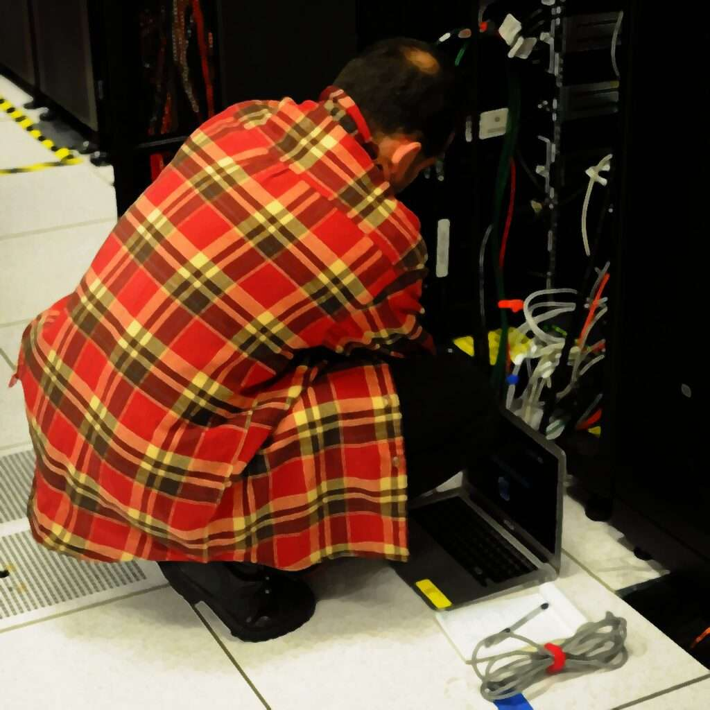

{ align=right width="250" loading=lazy }

Lakebase is Databricks' managed Postgres service. It runs next to the lakehouse on the same storage foundation. It shuts its compute down when nobody queries it, and it can branch a full copy of a production database in seconds. Databricks presents it as the transactional half of one platform, with Delta tables and Unity Catalog on the analytical side.

The service is more specific than the marketing suggests. It is ordinary Postgres with a managed control plane around it. The interesting part is where that control plane stops.

<!-- more -->

### The gap Lakebase targets

A Databricks SQL warehouse is built for large scans. A customer portal asks a different question: thousands of small lookups per second, each answered in milliseconds. Every write needs full ACID guarantees.

Those workloads have lived in a separate database for decades. A pipeline usually sat in between to keep both sides in sync.

Lakebase is the attempt to remove that second platform. Databricks announced it in June 2025, weeks after saying it would acquire Neon, the serverless Postgres company. Reports put that deal at about one billion dollars. Lakebase packages that architecture, and the same Postgres service is also sold on Neon's own platform.

### A standard Postgres, with the usual extensions

There is no new SQL dialect and no fork to learn. Lakebase runs Postgres 16, 17 or 18, with 17 as the default. The extension list covers what most apps expect. It includes pgvector 0.8 for embeddings, PostGIS 3.6 for spatial data, pgRouting, hll, pg_trgm, pg_stat_statements and pgcrypto.

Existing drivers, ORMs and migration tools work as they are. A `psql` prompt against a Lakebase branch looks like a `psql` prompt anywhere else. That is the point.

### Storage and compute are decoupled

A project holds branches, databases, roles and computes. Each branch gets one read-write compute, and that compute can have read replicas. Sizing is expressed in Compute Units. One CU brings about 2 GB of RAM plus the matching CPU and local SSD.

Autoscaling moves between 0.5 and 64 CU. It watches CPU load, memory use and the working set size. The gap between the minimum and the maximum cannot exceed 16 CU. Sizes from 65 to 112 CU exist as fixed computes. You reach those through the Postgres API, Terraform or the SDK rather than the UI.

Scale to zero is the other half of the cost model. An idle compute suspends after a timeout. You set it between 60 seconds and 7 days. The default is 24 hours. The next query wakes it in a few hundred milliseconds, and connection strings stay valid while it sleeps. Only active compute time is billed.

That mechanism has a price of its own. Suspending a compute closes its connections. Anything living in the session disappears with them: temporary tables, prepared statements, advisory locks, `LISTEN` and `NOTIFY`. Workloads that need that state must keep scale to zero switched off. The compute then runs around the clock.

### Branches and point-in-time recovery

Every project starts with a root branch called `production`. Further branches hang off it in a tree. A child inherits the schema and the data of its parent through copy-on-write pointers. Creating one takes seconds and copies no storage. Only blocks that change are written.

Children stay isolated. Schema changes, role grants and data edits on one branch do not touch its parent or its siblings. That makes per-developer branches and agent sandboxes practical. A branch can also start from any point in the parent's history. Point-in-time recovery and historical testing use the same mechanism.

### Unity Catalog: a read-only catalog, not magic

Registering a Lakebase database in Unity Catalog creates a catalog of type Lakebase Postgres. It mirrors the schemas, tables and views of the database. Permissions, lineage and audit logs then run through the same control layer as Delta tables. One SQL interface can query the data next to analytical tables.

Two details matter in practice. The catalog is read-only. You manage the database in Lakebase, and Unity Catalog syncs the metadata, so a new table shows up after a refresh.

The second detail is compute. Querying the catalog needs serverless compute: a serverless SQL warehouse, or serverless compute for notebooks and jobs. A Pro or classic warehouse fails with `UC_LAKEBASE_CATALOG_ACCESS_DENIED`. That error is confusing if you did not expect the restriction.

### Four patterns the service is built for

**Serving lakehouse data.** Synced tables copy a Unity Catalog table into Postgres through a managed Lakeflow pipeline. You pick a Gold table or a feature table and choose continuous, triggered or snapshot sync. The result is a read-only Postgres table that apps query by key. Continuous mode keeps it within seconds of the source.

Databricks advises read-only use of synced tables. Writes would drift from the source of truth. A beta option, LTAP Direct Writes, sends bulk loads straight to the storage layer. Those loads skip the compute endpoint.

**Operational data back into the lakehouse.** Lakebase Change Data Feed reads the Postgres write-ahead log. Every insert, update and delete becomes a row in a Unity Catalog managed Delta table, batched roughly every 15 seconds. Rows carry `_pg_change_type`, an LSN, a transaction ID and a timestamp, in the same shape as Delta Change Data Feed. That removes the Debezium or Kafka connector from the audit-trail story. Tables need `REPLICA IDENTITY FULL`, so the log holds both the old and the new row. The feature is in Public Preview.

**An application backend.** Any Postgres client connects, including Databricks Apps. Autoscaling absorbs traffic spikes without dropping connections. Branching replaces the seeding scripts that development environments usually need.

**Agents and machine learning.** Agents built with LangGraph or the OpenAI Agents SDK can keep conversation state in Postgres, next to the tables they read. Models served through Model Serving fetch real-time features from an online feature store backed by Lakebase. No separate Redis or DynamoDB cluster is needed.

### Where the architecture stops

The managed model removes things people rely on. There is no superuser and no access to the host operating system, so features that demand either are out. Postgres logs are not accessible. Parameters can be set at session, database or role level, but not at instance level. Unlogged and temporary tables live on the local disk of the compute. They do not survive a restart or a scale-to-zero cycle.

Storage scales to 8 TB per instance, per the docs. That is plenty for serving and agent workloads. It is far too small to archive raw history, which stays in Delta Lake and object storage.

Change Data Feed is a preview, and a workspace admin has to enable it. Teams that plan an audit trail around it should check the status in their own workspace first.

The lock-in is partial. The engine is standard Postgres, and logical replication is the documented way to move an existing database in. What you cannot take elsewhere is the layer around it: branching, the sync pipelines, autoscaling, scale to zero and the Unity Catalog integration. Leaving means rebuilding all of it.

A core ledger is a different matter. With unusual extensions, a superuser requirement or transactions that span systems outside Databricks, a dedicated cloud Postgres gives more control. Lakebase competes for work that sits close to analytics. It is not the database of record.

### When it fits

The service fits when the analytical data already lives on Databricks. An application, an agent or a model then needs that data with millisecond latency. It also fits when operational writes should land as Delta tables without an external CDC stack. A workspace that already has identity and billing in place gets a database with little setup.

It makes less sense as a general-purpose operational database for a team that does not use the lakehouse. Most of the value sits in the integration.

### Sources

- [Lakebase Postgres documentation](https://docs.databricks.com/aws/en/oltp/projects/)
- [Autoscaling](https://docs.databricks.com/aws/en/oltp/projects/autoscaling) and [scale to zero](https://docs.databricks.com/aws/en/oltp/projects/scale-to-zero)
- [Branches](https://docs.databricks.com/aws/en/oltp/projects/branches) and [manage computes](https://docs.databricks.com/aws/en/oltp/projects/manage-computes)
- [Postgres compatibility](https://docs.databricks.com/aws/en/oltp/projects/compatibility) and [Postgres extensions](https://docs.databricks.com/aws/en/oltp/projects/extensions)
- [Register a Lakebase database in Unity Catalog](https://docs.databricks.com/aws/en/oltp/projects/register-uc)
- [Serve lakehouse data with synced tables](https://docs.databricks.com/aws/en/oltp/projects/sync-tables) and [Lakebase Change Data Feed](https://docs.databricks.com/aws/en/oltp/projects/lakebase-cdf)
- [Use cases](https://docs.databricks.com/aws/en/oltp/projects/use-cases)
- [Databricks Lakebase is now Generally Available](https://www.databricks.com/blog/databricks-lakebase-generally-available) and [Lakebase Postgres is now generally available on Google Cloud](https://www.databricks.com/blog/lakebase-postgres-now-generally-available-google-cloud)
- [Databricks scales Lakebase to 8TB per instance](https://developers.databricks.com/perspectives/what-operational-database-scales-to-8tb-per-instance-while-remaining-fully-serverless-and-auto-managed-for-enterprise-production-workloads)
- [Databricks agrees to acquire Neon](https://www.databricks.com/company/newsroom/press-releases/databricks-agrees-acquire-neon-help-developers-deliver-ai-systems) (May 14, 2025)
- Image: [Technician with laptop working on server rack at NERSC](https://commons.wikimedia.org/wiki/File:Technician_with_laptop_working_on_server_rack_at_NERSC.jpg), Derrick Coetzee, Wikimedia Commons (CC0), painterly filter
